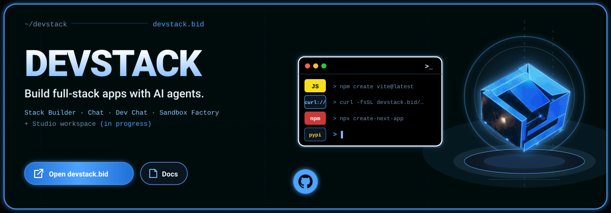
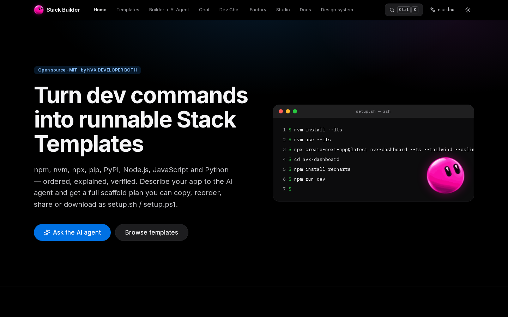

<div align="center">



<br/>

[](https://devstack.bid)
[](https://devstack.bid/docs)
[](./LICENSE)

</div>

# DevStack · devstack.bid

> 🚧 **Branch `feat/studio` · v0.8.0-rc.2 (preview, not deployed yet).** This branch merges the Studio workspace into DevStack. devstack.bid still runs v0.7.0 from `main`, so the `/studio/` link below works only after this branch ships. You can run it locally with `npm run preview`.
>
> 🚧 **Branch `feat/studio` · v0.8.0-rc.2 (ยังไม่ deploy)** branch นี้รวม Studio เข้ากับ DevStack ตอนนี้ devstack.bid ยังเป็น v0.7.0 จาก `main` ลิงก์ `/studio/` ด้านล่างจะใช้ได้หลัง branch นี้ขึ้นระบบจริง ระหว่างนี้รันในเครื่องได้ด้วย `npm run preview`

An open developer platform from the NVX community. You can turn setup commands into runnable **Stack Templates**, chat with free AI models, run an AI agent with a sandbox, bring your own OpenAI key to the **Sandbox Factory**, or build a full-stack app in your browser with the **Studio**. The whole site is Thai + English.

แพลตฟอร์มนักพัฒนาแบบเปิดจากคอมมูนิตี้ NVX เปลี่ยนคำสั่งติดตั้งให้เป็น **Stack Template** ที่รันได้จริง แชตกับ AI ฟรี ให้ agent ทำงานใน sandbox ใช้ OpenAI key ของตัวเองใน **Sandbox Factory** หรือสร้างแอป full-stack ในเบราว์เซอร์ด้วย **Studio** ทั้งเว็บใช้ได้ทั้งภาษาไทยและอังกฤษ

**Live:** https://devstack.bid · **Docs / เอกสาร:** [docs/README.md](./docs/README.md) (also at https://devstack.bid/docs) · **AI agents:** [AGENTS.md](./AGENTS.md), [`/llms.txt`](https://devstack.bid/llms.txt) · MIT License



## What's inside / มีอะไรบ้าง

| App | Path | What it does | AI and cost |
| --- | --- | --- | --- |
| **Learn** | [`/learn`](https://devstack.bid/learn) | Launch page for the whole system, made by the creator [email redacted] and Cursor. The homepage **Ask the AI agent** button opens it. Every page header has **Setup Cursor** (create a project or ask Cursor). | — |
| **Stack Builder** | [`/templates`](https://devstack.bid/templates), [`/builder`](https://devstack.bid/builder) | 10 curated Stack Templates (Next.js, Vite, Express, FastAPI, Streamlit, CLI, PyPI …). Pick versions and add-ons, then reorder, share as a link, or download `setup.sh` / `setup.ps1` / a starter zip. The AI planner turns a description into a stack. | Planner: Hugging Face DeepSeek V3, falling back to an offline rule-based planner. You can also bring your own OpenAI key. |
| **Chat** | [`/chat`](https://devstack.bid/chat) | A free AI chat (General, Thai, Code, Stronger and Image modes) with history saved per browser. | Workers AI (Gemma 4, SEA-LION, Qwen Coder, FLUX) and HF DeepSeek V3, with free daily quotas. |
| **Dev Chat** | [`/chat/dev`](https://devstack.bid/chat/dev) | The Image and Research Orchestrator agent, with a live sandbox panel (commands, subagents, files). | OpenAI Agents API on our key, capped at a few turns per day. |
| **Sandbox Factory** | [`/factory`](https://devstack.bid/factory) | Your own agent and sandbox (OpenAI-hosted or self-hosted `codex exec-server`). | Your OpenAI key, sent per request and never stored. |
| **Studio** (beta) | [`/studio/`](https://devstack.bid/studio/) | Four agents (Core, Code, DB, Design) build a full-stack app in your browser: a static live preview (Sucrase + sandboxed iframe, React only), PGlite + pgvector, AI images, and a one-click export (source, SQL, Prisma, Vercel/Cloudflare/Docker). | Workers AI, then HF DeepSeek, through our server with free daily quotas. Mock agents when AI is unavailable. |
| **Docs** | [`/docs`](https://devstack.bid/docs) | 54 pages: user guides, architecture, operations, reference. Each one is also served as raw Markdown for AI agents. | — |
| **NVXDEV** | `npx nvxdev init`, `pip install nvxdev` | The DevStack CLI. It is reserved in the terminal signature but **not published yet** (hidden until the packages exist on npm and PyPI). | — |

Commands are **text only**: our server never executes user, AI or template commands. Studio code runs only inside your browser (sandboxed preview iframe and PGlite).

เซิร์ฟเวอร์ของเรา **ไม่รันคำสั่งใด ๆ** ของผู้ใช้ AI หรือเทมเพลต โค้ดใน Studio รันในเบราว์เซอร์ของคุณเท่านั้น

## Quick start / เริ่มต้น

Requirements: Node.js 22+ and npm. Studio's end-to-end tests also need Chromium (`npx playwright install chromium`).

```bash
git clone https://github.com/agents-sdk-space/devstack.bid.git
cd devstack.bid
npm install                       # also patches the OpenNext adapter (postinstall)
cp .dev.vars.example .dev.vars    # optional: CHAT_COOKIE_SECRET, HF_TOKEN, OPENAI_API_KEY (server-side only)
npm run dev                       # Next.js on http://localhost:3000
```

Production-style local run (Cloudflare Workers runtime, the same headers as devstack.bid). This builds the Studio, the docs bundle and the Worker:

```bash
npm run preview                   # http://localhost:8787  ->  open /studio/ and type "build a todo app"
```

Without any keys everything still works. The planner uses its offline rules, the Studio uses deterministic mock agents and placeholder images, and the chats report that they are unavailable.

ไม่มี key ก็ใช้ได้: planner ใช้กฎแบบออฟไลน์ Studio ใช้ agent จำลองและภาพ placeholder ส่วนแชตจะแจ้งว่ายังไม่พร้อมใช้งาน

## Scripts

| Script | What it does |
| --- | --- |
| `npm run dev` | Next.js dev server (:3000) with Cloudflare bindings |
| `npm run studio:dev` | Studio Vite dev server (:43123) with hot reload. It proxies `/api` to `npm run dev`. |
| `npm run build` | Docs bundle, then the Studio (`public/studio/`), then `next build` |
| `npm run preview` | OpenNext build plus `wrangler dev` (:8787): the real Workers runtime, headers and 404s |
| `npm run lint` / `npm run typecheck` / `npm test` | ESLint, `tsc --noEmit`, Vitest (site, API, quotas, Studio proxy and headers) |
| `npm run studio:check` | Studio brand sync, ESLint, `tsc -b` and Vitest (agents, PGlite + pgvector, export, static preview bundler) |
| `npm run studio:e2e` | Playwright against a running preview: the full "build a todo app" flow plus site regressions |
| `npm run docs:check` | Docs freshness: links, paths, env vars, scripts, manifest |
| `npm run licenses` / `licenses:check` | Regenerate / verify [THIRD_PARTY_LICENSES.md](./THIRD_PARTY_LICENSES.md) (permissive licenses only; also enforced by `npm test`) |
| `npm run export -- <id> --out dir` | Writes `setup.sh` / `setup.ps1` / `README.md` for a template |
| `npm run deploy` | Build plus deploy to Cloudflare. **Needs owner approval** ([deploy guide](./docs/operations/deploy-cloudflare.md)). |

The full list is in [docs/reference/npm-scripts.md](./docs/reference/npm-scripts.md).

## Architecture

```
Browser (no secrets)                                        Cloudflare Worker "nvx-stack-builder" (Next.js 16 via OpenNext)
───────────────────────────────────────────────────         ────────────────────────────────────────────────────────────────
/, /learn, /templates, /builder, /docs  (prerendered pages) ◄──  static assets + App Router, site CSP (no COEP)
/builder AI panel ──────────────────────────────────────►  POST /api/plan ─────────► HF DeepSeek V3 → offline planner
/chat ──────────────────────────────────────────────────►  /api/chat/turn ─────────► Workers AI (AI binding) ⇄ HF router
/chat/dev ──────────────────────────────────────────────►  /api/chat/dev/turn ─────► OpenAI Agents API (server key, low caps)
/factory (your key, per request) ───────────────────────►  /api/factory/* ─────────► OpenAI Agents API (your key)
/studio/  (static Vite app, COOP + COEP, Studio CSP)
  AgentOrchestrator → Code / DB / Design agents ────────►  /api/studio/llm/chat ───► Workers AI (Qwen Coder) → HF DeepSeek
  Static preview (Sucrase, sandboxed iframe) · PGlite ───►  /api/studio/image ──────► Workers AI FLUX
  Export (JSZip)                                            └ cookie identity (HMAC) · D1 nvx-db quotas · rate-limit bindings
```

- **Stack:** Next.js 16.4 App Router, React 19, TypeScript and Tailwind v4, deployed to Cloudflare Workers with `@opennextjs/cloudflare`. Storage is D1 `nvx-db` (chat history and quota counters). AI is the Workers AI binding plus the Hugging Face router.
- **Studio:** a separate Vite + React app in [`studio/`](./studio/) with its own lockfile. It is built into `public/studio/` and served by the same Worker from static assets. COOP/COEP and the Studio CSP are scoped to `/studio/*` only; the preview page `/studio/preview/` has its own no-network CSP. See [docs/architecture/studio.md](./docs/architecture/studio.md).
- **Design system:** a black, terminal-style "Apple developer" look with the NVX tokens (`src/app/tokens.css`), the animated pink-blob mascot, and the DevStack terminal signature window. The Studio receives a synced copy (`npm run studio:brand`). See [docs/concepts/design-system.md](./docs/concepts/design-system.md).

## Key handling / การจัดการ key

- The browser only ever calls our own `/api/*`. Server keys (`OPENAI_API_KEY`, `HF_TOKEN`, `CHAT_COOKIE_SECRET`) are Worker **secrets** set with `wrangler secret put` (stdin). They are never `NEXT_PUBLIC_`, never bundled and never logged, and error messages are redacted.
- The Studio has **no key of its own**. DEVSTACK's original `LLM_API_KEY` proxy was replaced by `/api/studio/*`, which uses the Workers AI binding and the existing HF token.
- Sandbox Factory and the planner accept **your** OpenAI key in the `x-openai-key` header of a single request. It is never stored.
- Every AI endpoint has a per-IP burst limiter (Workers Rate Limiting) plus daily quotas in D1 per signed cookie, per IP and site-wide. Quotas reset at midnight Bangkok time, and failed calls are refunded.

key ของเซิร์ฟเวอร์เป็น secret ของ Worker เท่านั้น ไม่เคยถึงเบราว์เซอร์ Studio ไม่มี key ของตัวเอง ทุก endpoint ที่ใช้ AI มีเพดานต่อนาทีและโควตาต่อวัน

## Fallbacks / ทางสำรอง

| When | What happens |
| --- | --- |
| No `OPENAI_API_KEY` / HF down | The planner uses its offline rule-based plans |
| A Workers AI model fails | Chat and Studio move to HF DeepSeek V3 (and HF to Workers AI) |
| No AI or D1 on the server, or the Studio quota is used up | Studio agents use deterministic mock LLM, template schema/app and placeholder images. The chat shows `CodeAgent (mock)` etc. |
| Generated code does not compile or imports a package other than `react` / `react-dom` | The preview shows the error and the Output tab names the file. Agents, DB, assets and export keep working. |
| R2 not enabled | Chat attachments return `uploads_disabled` |

## Deploy

devstack.bid runs on Cloudflare Workers (Worker `nvx-stack-builder`, custom domains `devstack.bid` + `www`). Deploying, pushing, merging to `main`, DNS changes and new Cloudflare resources all **require the owner's approval** (see [AGENTS.md](./AGENTS.md)).

```bash
npm run lint && npm run typecheck && npm test && npm run docs:check && npm run studio:check
npm run cf:build                 # includes the Studio build (public/studio, ~34 MB, largest file 10 MB < 25 MiB limit)
npm run deploy                   # approval required
```

Step-by-step guide, secrets, D1 migrations and rollback: [docs/operations/deploy-cloudflare.md](./docs/operations/deploy-cloudflare.md) · [docs/operations/env-secrets.md](./docs/operations/env-secrets.md) · [docs/operations/rollback.md](./docs/operations/rollback.md).

## Contributing / ร่วมพัฒนา

We welcome issues and pull requests. Please read [CONTRIBUTING.md](./CONTRIBUTING.md) and the [Code of Conduct](./CODE_OF_CONDUCT.md). To add a template, follow [docs/contributing/add-template.md](./docs/contributing/add-template.md). Keep both languages in every UI string and update the docs in the same change.

เรายินดีรับ issue และ pull request ทุกขนาด อ่าน [CONTRIBUTING.md](./CONTRIBUTING.md) ก่อนเริ่ม ทุกข้อความใน UI ต้องมีทั้งไทยและอังกฤษ และอัปเดตเอกสารใน PR เดียวกัน

## License

[MIT](./LICENSE) © NVX DEVELOPER BOTH and contributors. The Studio is the team's DEVSTACK workspace (v0.2.0), merged into this repository under the same license. Every dependency is open source under a permissive license (MIT, ISC, BSD, Apache-2.0, OFL-1.1 for fonts; PGlite/pgvector under Apache-2.0 / the PostgreSQL License) with no commercial or usage-based terms: see [THIRD_PARTY_LICENSES.md](./THIRD_PARTY_LICENSES.md). Tool logos come from [Simple Icons](https://simpleicons.org) (CC0) and are trademarks of their owners ([NOTICE](./NOTICE)).
