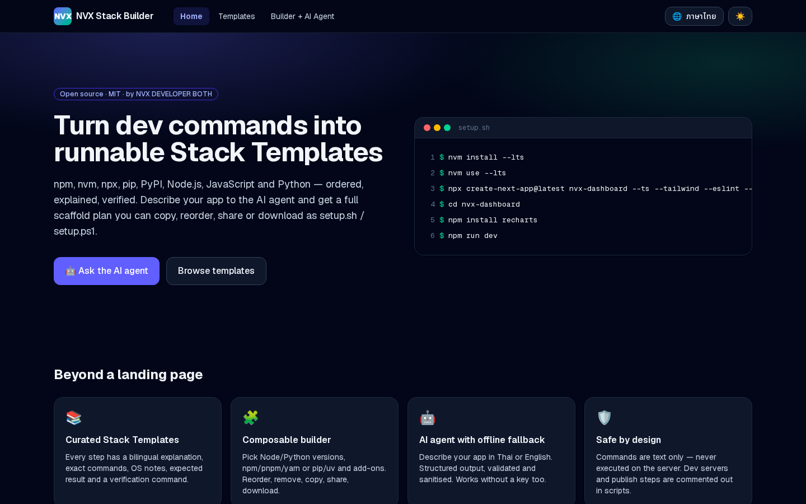
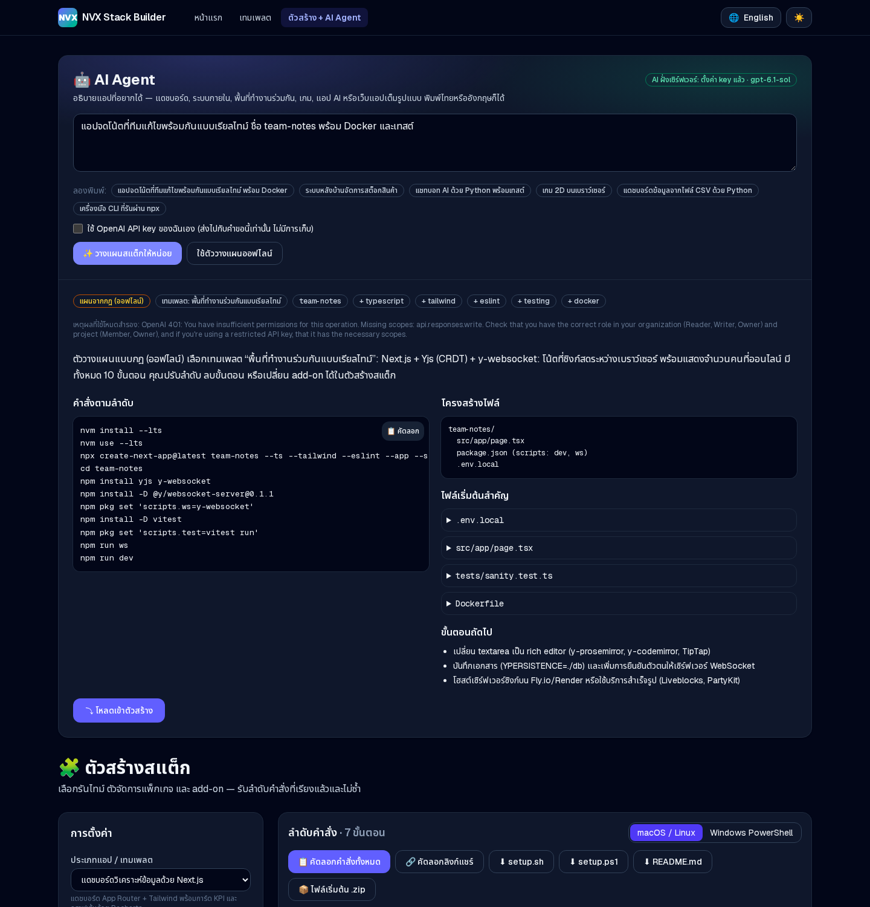
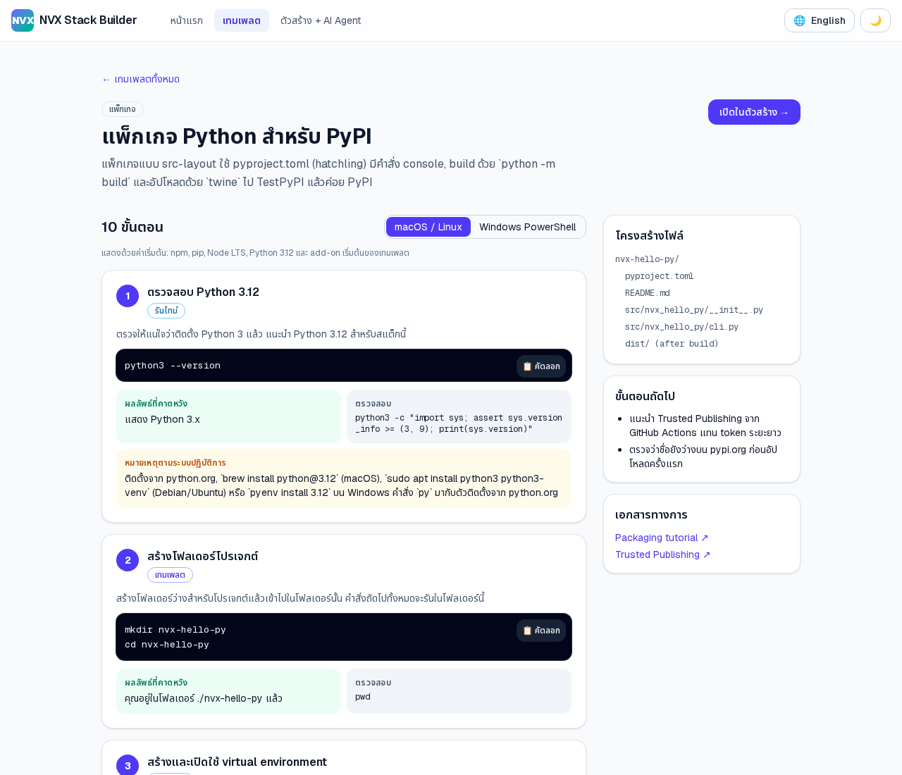

# NVX Stack Builder

> Turn developer command sequences (npm · nvm · npx · pip · PyPI · Node.js · JavaScript · Python) into ordered, runnable **Stack Templates** — with an AI agent that plans full apps.
>
> เปลี่ยนลำดับคำสั่งของนักพัฒนาให้เป็น **Stack Template** ที่เรียงลำดับแล้วและรันได้จริง — พร้อม AI agent ที่ช่วยวางแผนสร้างแอปทั้งระบบ

Built by **NVX DEVELOPER BOTH** · Open source under the [MIT License](./LICENSE).

[English](#english) · [ภาษาไทย](#ภาษาไทย)



---

## English

### What it is

NVX Stack Builder is a Next.js web app that:

- **Template catalog** — 10 curated Stack Templates (Next.js dashboard, Vite + React canvas game, Express REST API, FastAPI + OpenAI app, Streamlit data dashboard, Node CLI via `npx`, Python package for PyPI, realtime collaborative workspace with Yjs, React Admin internal tool, Next.js AI chat). Every step has a Thai + English explanation, exact commands, OS notes, the expected result and a verification command.
- **Stack Builder** — pick the Node.js version (nvm), Python version, package manager (npm / pnpm / yarn, pip / uv), app type and add-ons (TypeScript, Tailwind, ESLint/Ruff, testing, Docker, GitHub Actions CI). It composes an ordered, de-duplicated command sequence you can reorder, remove, extend, copy, share as a link, or download as `setup.sh`, `setup.ps1`, `README.md` or a starter `.zip`.
- **AI agent** — describe your app in Thai or English. A server route calls the OpenAI **Responses API** with **Structured Outputs** (JSON Schema) and returns a plan: chosen template, ordered commands, file tree, key starter files and next steps — one click loads it into the builder. Output is validated (zod) and sanitised (dangerous commands removed, risky ones marked manual, unsafe paths dropped). If no key is configured or the API fails, a deterministic **rule-based planner** answers instead, so the feature always works.
- **Thai / English** toggle, **dark mode**, responsive and accessible UI (skip link, labelled controls, live regions, keyboard-friendly).
- **Share links** — the whole stack (config + your edits) is encoded in the URL hash (`/builder#s=...`). The hash never reaches the server.

Commands are **text only**. Nothing is ever executed on the server. In generated scripts, dev servers, publish steps (`npm publish`, `twine upload`) and manual steps are commented out.

### Run locally

Requirements: Node.js 20.9+ (Node 22 LTS recommended), npm.

```bash
git clone <your-fork-url> nvx-stack-builder
cd nvx-stack-builder
npm install
cp .env.example .env.local      # optional: add OPENAI_API_KEY for the real AI agent
npm run dev                     # http://localhost:3000
```

Production:

```bash
npm run build
npm start                       # PORT=3000 by default
```

Other scripts:

| Command | What it does |
| --- | --- |
| `npm test` | Unit tests (Vitest) for the composer, scripts, share links, sanitiser and planners |
| `npm run lint` | ESLint |
| `npm run typecheck` | `tsc --noEmit` |
| `npm run export -- <templateId> [--name x] [--pm pnpm] [--py uv] [--addons typescript,docker] [--out dir]` | Write `setup.sh` / `setup.ps1` / `README.md` for a template from the CLI |

### Environment variables

| Variable | Required | Description |
| --- | --- | --- |
| `OPENAI_API_KEY` | no | Server-side key for `/api/plan`. Needs Responses API permission (`api.responses.write`). Without it the rule-based planner is used. |
| `OPENAI_MODEL` | no | Model for the agent. Default `gpt-6.1-sol`. |

Users can also paste **their own key** in the agent panel. It is sent only in the `x-openai-key` header of that single request and is never stored or logged by the server. Requests using the shared server key are rate-limited (10 per 10 minutes per IP, in-memory).

### API

`POST /api/plan` — body `{ "prompt": string, "lang": "en" | "th", "mode"?: "auto" | "fallback" }`, optional header `x-openai-key`. Returns an `AgentPlan` (`source: "openai" | "fallback"`, `fallbackReason`, `templateId`, `addons`, `extraSteps`, `fileTree`, `starterFiles`, `nextSteps`, `warnings`).

`GET /api/plan` — `{ serverKeyConfigured, model }`.

### Project structure

```
src/
  app/                    Next.js App Router pages + /api/plan route
  components/             UI (builder, agent panel, step cards, catalog, prefs/i18n hooks)
  data/
    templates/            ← one file per Stack Template (+ index.ts registry)
    common-steps.ts       reusable steps (create-next-app, create-vite, venv, ...)
    runtime-steps.ts      nvm / pnpm / yarn / python / uv setup steps
    addon-steps.ts        TypeScript, Tailwind, lint, tests, Docker, CI
  lib/
    composer.ts           compose + de-duplicate + apply user edits
    placeholders.ts       {{placeholders}} for package managers / versions
    scripts.ts            setup.sh / setup.ps1 / README generators
    share.ts              URL-hash share encoding (validated)
    sanitize.ts           untrusted-content sanitiser
    ai/                   OpenAI client, JSON schema, plan validation, fallback planner
tests/                    Vitest unit tests
scripts/export-template.ts  CLI exporter for contributors
```

### How to add a template

1. Create `src/data/templates/<your-id>.ts` that default-exports a `StackTemplate` (copy an existing one, e.g. `express-api.ts`).
2. Fill in `name` / `summary` (both `en` and `th`), `category`, `runtimes`, `supportedAddons`, `keywords` (EN + TH — used by the offline planner), `fileTree`, `docs`, and the ordered `steps`.
3. Each step needs: `id`, `title`, `explanation`, `commands` (POSIX), optional `windows` (PowerShell), optional `files`, `osNotes`, `expected`, `verify`, and `kind` (`setup` · `longRunning` · `publish` · `manual`).
4. Use placeholders instead of hard-coding package managers: `{{name}}`, `{{install}}`, `{{add}}`, `{{addDev}}`, `{{run}}`, `{{pip}}`, `{{venv}}`, `{{activate}}` … (full list in `src/lib/placeholders.ts`). Wrap TypeScript-only syntax in starter files with `⟨ ⟩` so it is stripped for JS projects.
5. Register it in `src/data/templates/index.ts`.
6. Test it for real: `npm run export -- <your-id> --out /tmp/try && cd /tmp/try && bash setup.sh`, then `npm test && npm run build`.

See [CONTRIBUTING.md](./CONTRIBUTING.md) for the full checklist.

### Deploy

- **Vercel**: import the GitHub repo → framework "Next.js" → add `OPENAI_API_KEY` (optional) and `OPENAI_MODEL` → Deploy.
- **Cloudflare Workers**: use the OpenNext adapter (`@opennextjs/cloudflare`), set the env vars as secrets, `npx opennextjs-cloudflare build && npx opennextjs-cloudflare deploy`.
- **Any Node host / Docker**: `npm ci && npm run build && npm start`.

---

## ภาษาไทย

### คืออะไร

NVX Stack Builder เป็นเว็บแอป Next.js ที่:

- **คลังเทมเพลต** — Stack Template คัดสรร 10 แบบ (แดชบอร์ด Next.js, เกม Canvas ด้วย Vite + React, REST API ด้วย Express, แอป AI ด้วย FastAPI + OpenAI, แดชบอร์ดข้อมูลด้วย Streamlit, CLI ที่รันผ่าน `npx`, แพ็กเกจ Python สำหรับ PyPI, พื้นที่ทำงานร่วมกันแบบเรียลไทม์ด้วย Yjs, ระบบหลังบ้านด้วย React Admin, แอปแชท AI ด้วย Next.js) ทุกขั้นตอนมีคำอธิบายไทย + อังกฤษ คำสั่งที่ถูกต้อง หมายเหตุตามระบบปฏิบัติการ ผลลัพธ์ที่คาดหวัง และคำสั่งตรวจสอบ
- **ตัวสร้างสแต็ก** — เลือกเวอร์ชัน Node.js (nvm), เวอร์ชัน Python, ตัวจัดการแพ็กเกจ (npm / pnpm / yarn, pip / uv), ประเภทแอป และ add-on (TypeScript, Tailwind, ESLint/Ruff, เทสต์, Docker, GitHub Actions CI) ระบบจะเรียงคำสั่งให้และตัดคำสั่งซ้ำออก คุณจัดลำดับใหม่ ลบ เพิ่มขั้นตอนเอง คัดลอก แชร์เป็นลิงก์ หรือดาวน์โหลดเป็น `setup.sh`, `setup.ps1`, `README.md` หรือไฟล์ `.zip` ได้
- **AI agent** — อธิบายแอปที่ต้องการเป็นภาษาไทยหรืออังกฤษ เซิร์ฟเวอร์จะเรียก OpenAI **Responses API** แบบ **Structured Outputs** (JSON Schema) แล้วคืนแผน: เทมเพลตที่เลือก, คำสั่งตามลำดับ, โครงสร้างไฟล์, ไฟล์เริ่มต้นสำคัญ และขั้นตอนถัดไป — กดครั้งเดียวก็โหลดเข้าตัวสร้างได้ ผลลัพธ์ผ่านการตรวจสอบ (zod) และกรองความปลอดภัย (ตัดคำสั่งอันตราย, ทำเครื่องหมายคำสั่งเสี่ยงให้รันเอง, ตัด path ที่ไม่ปลอดภัย) ถ้าไม่มี key หรือ API ล้มเหลว จะใช้ **ตัววางแผนแบบกฎ** ที่ทำงานแบบออฟไลน์แทน จึงใช้งานได้เสมอ
- สลับ **ไทย / อังกฤษ**, **โหมดมืด**, รองรับมือถือ และเข้าถึงได้ (accessible)
- **ลิงก์แชร์** — การตั้งค่าและการแก้ไขทั้งหมดถูกเข้ารหัสไว้ใน URL hash (`/builder#s=...`) ซึ่งไม่ถูกส่งไปที่เซิร์ฟเวอร์

คำสั่งทั้งหมดเป็น **ข้อความเท่านั้น** ไม่มีการรันบนเซิร์ฟเวอร์ ในสคริปต์ที่สร้าง ขั้นตอน dev server, การ publish (`npm publish`, `twine upload`) และขั้นตอนที่ต้องตรวจสอบเองจะถูกคอมเมนต์ไว้

### วิธีรัน

ต้องมี Node.js 20.9 ขึ้นไป (แนะนำ Node 22 LTS) และ npm

```bash
git clone <your-fork-url> nvx-stack-builder
cd nvx-stack-builder
npm install
cp .env.example .env.local      # ไม่บังคับ: ใส่ OPENAI_API_KEY เพื่อใช้ AI จริง
npm run dev                     # เปิด http://localhost:3000
```

Production: `npm run build` แล้ว `npm start`

ทดสอบ: `npm test` · ตรวจโค้ด: `npm run lint` · ตรวจ type: `npm run typecheck`

### ตัวแปรสภาพแวดล้อม

- `OPENAI_API_KEY` (ไม่บังคับ) — key ฝั่งเซิร์ฟเวอร์สำหรับ `/api/plan` ต้องมีสิทธิ์เรียก Responses API (`api.responses.write`) ถ้าไม่มีจะใช้ตัววางแผนแบบกฎ
- `OPENAI_MODEL` (ไม่บังคับ) — ค่าเริ่มต้น `gpt-6.1-sol`

ผู้ใช้สามารถใส่ **key ของตัวเอง** ในหน้า AI agent ได้ key จะถูกส่งไปกับคำขอนั้นครั้งเดียวผ่าน header `x-openai-key` และเซิร์ฟเวอร์ไม่เก็บหรือบันทึก log

### วิธีร่วมพัฒนา

1. Fork แล้วสร้าง branch ใหม่
2. `npm install` แล้ว `npm run dev`
3. แก้ไข เพิ่มเทสต์ แล้วรัน `npm test && npm run lint && npm run build` ให้ผ่าน
4. เปิด Pull Request พร้อมอธิบายการเปลี่ยนแปลง (ไทยหรืออังกฤษก็ได้)

รายละเอียดดูที่ [CONTRIBUTING.md](./CONTRIBUTING.md) และโปรดปฏิบัติตาม [CODE_OF_CONDUCT.md](./CODE_OF_CONDUCT.md)

### วิธีเพิ่มเทมเพลต

1. สร้างไฟล์ `src/data/templates/<id>.ts` ที่ `export default` เป็น `StackTemplate` (คัดลอกจากไฟล์ที่มีอยู่ เช่น `express-api.ts`)
2. ใส่ `name` / `summary` ทั้ง `en` และ `th`, `category`, `runtimes`, `supportedAddons`, `keywords` (ไทย + อังกฤษ ใช้กับตัววางแผนออฟไลน์), `fileTree`, `docs` และ `steps` ตามลำดับ
3. แต่ละขั้นตอนต้องมี `id`, `title`, `explanation`, `commands` (POSIX), `windows` (PowerShell ถ้าต่างกัน), `files`, `osNotes`, `expected`, `verify` และ `kind`
4. ใช้ placeholder เช่น `{{name}}`, `{{install}}`, `{{add}}`, `{{run}}`, `{{pip}}`, `{{venv}}` แทนการเขียนชื่อ package manager ตายตัว (ดูทั้งหมดใน `src/lib/placeholders.ts`) และครอบ syntax เฉพาะ TypeScript ด้วย `⟨ ⟩`
5. ลงทะเบียนใน `src/data/templates/index.ts`
6. ทดสอบจริง: `npm run export -- <id> --out /tmp/try && cd /tmp/try && bash setup.sh` แล้ว `npm test && npm run build`

### Deploy

- **Vercel**: import repo จาก GitHub → ตั้ง `OPENAI_API_KEY` / `OPENAI_MODEL` → Deploy
- **Cloudflare**: ใช้ `@opennextjs/cloudflare` แล้ว deploy ด้วย Wrangler
- **เซิร์ฟเวอร์ Node / Docker**: `npm ci && npm run build && npm start`

---

## Screenshots

| Home | Builder + AI agent | Template (Thai, light) |
| --- | --- | --- |
|  |  |  |
