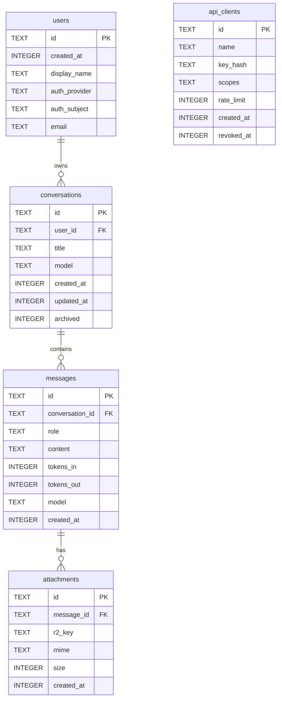

# โมเดลข้อมูลแชต · Chat data model (D1 + R2)

หน้านี้อธิบายว่าเราเก็บประวัติแชตระหว่างผู้ใช้กับ AI ไว้อย่างไร ตารางหลักอยู่ใน D1 (`nvx-db`) และหน้า `/chat` อ่านเขียนตารางเหล่านี้อยู่แล้ว รายละเอียด route อยู่ที่ [reference/api-chat.md](../reference/api-chat.md)

การเข้าสู่ระบบใช้ GitHub OAuth migration `0006_github_auth` เพิ่ม `users.login`, `users.avatar_url` และตาราง `github_credentials` ที่เก็บเฉพาะ ciphertext ของ access token (AES-GCM จาก `CHAT_COOKIE_SECRET`) cookie `nvx_auth` เป็นรหัสผู้ใช้ที่ลงลายเซ็น ไม่ใช่ token แผนเดิมที่ยังไม่ทำ (API key สำหรับบริการภายนอก, R2) อยู่ท้ายหน้า

## เป้าหมาย

1. เก็บบทสนทนาของผู้ใช้กับ AI ได้ครบ (ข้อความทุก role, โมเดลที่ใช้, จำนวน token) เพื่อเปิดต่อ ค้นย้อนหลัง และคิดต้นทุนได้
2. ไฟล์แนบอยู่ใน R2 ส่วน D1 เก็บแค่ key และ metadata เพื่อให้ฐานข้อมูลเล็กและเร็ว
3. ให้ AI หรือบริการอื่นเชื่อมต่อผ่าน API key ที่ **เราออกและเพิกถอนได้เอง** โดยเก็บแค่ hash ของ key
4. ไม่ผูกกับผู้ให้บริการ auth รายใด คอลัมน์ auth จึงเป็น nullable ไว้ก่อน

## แผนภาพ

`api_clients` ไม่ผูก foreign key กับตารางอื่น เพราะเป็นตัวตนของ "เครื่อง" ที่เข้ามาใช้ API ไม่ใช่ผู้ใช้คน

## การตัดสินใจหลัก

| เรื่อง | ทางที่เลือก | เหตุผล |
|---|---|---|
| ชนิดของ id | `TEXT` (UUIDv7 หรือ ULID ที่แอปสร้าง) | เรียงตามเวลาได้ ไม่เดาง่ายแบบเลขรัน และสร้างได้ก่อน insert (ใช้ทำ R2 key ได้ทันที) |
| เวลา | `INTEGER` เป็น Unix epoch มิลลิวินาที (UTC) | เทียบและเรียงได้เร็ว ไม่มีปัญหา timezone; ค่า default มาจาก `unixepoch('subsec') * 1000` |
| boolean | `INTEGER` 0/1 พร้อม `CHECK` | SQLite ไม่มีชนิด boolean |
| ตาราง | `STRICT` | SQLite บังคับชนิดคอลัมน์จริง ไม่ยอมให้ใส่ข้อความลงคอลัมน์ตัวเลข |
| role | `CHECK (role IN ('user','assistant','system','tool'))` | กันค่าแปลกตั้งแต่ระดับฐานข้อมูล |
| การลบ | `ON DELETE CASCADE` จาก users → conversations → messages → attachments | ลบผู้ใช้ทีเดียวได้ข้อมูลหายครบ (ตรงกับคำขอลบข้อมูลส่วนบุคคล) แต่ **วัตถุใน R2 ต้องลบเองจากโค้ด** เพราะ D1 สั่ง R2 ไม่ได้ |
| ไฟล์แนบ | bytes อยู่ R2, D1 เก็บ `r2_key` (unique), `mime`, `size` | D1 จำกัดขนาดแถวและฐานข้อมูล ไฟล์ใหญ่จึงไม่ควรอยู่ใน D1 |
| API key | เก็บ `key_hash` = SHA-256 hex ของ key เต็ม (unique) | key จริงแสดงครั้งเดียวตอนสร้าง ถ้าฐานข้อมูลรั่วก็ใช้ key ไม่ได้; key สุ่มยาวพอจึงไม่ต้องใช้ hash แบบช้า |
| scopes | JSON array ในคอลัมน์ `TEXT` พร้อม `CHECK (json_valid(...))` | ยืดหยุ่น เพิ่ม scope ใหม่ได้โดยไม่ต้อง migrate |
| `updated_at` ของบทสนทนา | แอปอัปเดตเองทุกครั้งที่เพิ่มข้อความ (ไม่ใช้ trigger) | ควบคุมได้ชัดและอยู่ใน batch เดียวกับ insert ข้อความ |

## Index และ query ที่รองรับ

| Query | Index |
|---|---|
| รายการบทสนทนาของผู้ใช้ เรียงล่าสุดก่อน ซ่อนที่เก็บถาวร | `conversations_user_updated_idx (user_id, archived, updated_at DESC)` |
| โหลดข้อความในบทสนทนาตามลำดับ และแบ่งหน้าด้วย `created_at` | `messages_conversation_created_idx (conversation_id, created_at, id)` |
| ไฟล์แนบของข้อความ | `attachments_message_idx (message_id)` |
| หา API client จาก key | unique index บน `key_hash` |
| รายการ API client ที่ยังใช้งานได้ | `api_clients_active_created_idx (created_at DESC) WHERE revoked_at IS NULL` |
| หาผู้ใช้จากตัวตนของผู้ให้บริการ auth | `users_auth_identity_uq (auth_provider, auth_subject)` (unique) |

## Migration

ไฟล์อยู่ในโฟลเดอร์ `migrations/` และรันตามลำดับชื่อ:

- `0001_schema_meta.sql`: ตาราง `schema_meta` (key/value) พร้อม `schema_version = 1`
- `0002_chat_history.sql`: ทั้ง 5 ตารางและ index แล้วตั้ง `schema_version = 2`

wrangler บันทึกว่ารันไฟล์ไหนไปแล้วในตาราง `d1_migrations` ห้ามแก้ไฟล์ที่ apply ไปแล้ว ถ้าจะเปลี่ยน schema ให้สร้างไฟล์ใหม่ (`0003_...sql`) ขั้นตอนดูที่ [operations/d1-database.md](../operations/d1-database.md) รายละเอียดคอลัมน์ดูที่ [reference/d1-schema.md](../reference/d1-schema.md)

## สถานะ R2

bucket `nvx-assets` (binding `ASSETS_BUCKET`) **ยังไม่ได้สร้าง** เพราะบัญชียังไม่เปิดใช้ R2 (API ตอบ error 10042 "Please enable R2 through the Cloudflare Dashboard") การเปิด R2 ต้องยอมรับเงื่อนไขการใช้งานและการคิดเงินใน dashboard ซึ่งเจ้าของบัญชีต้องตัดสินใจเอง ตาราง `attachments` ออกแบบรอไว้แล้ว และ binding จะเพิ่มใน `wrangler.jsonc` หลัง bucket มีจริงเท่านั้น (ถ้าใส่ก่อน deploy จะล้ม)

## แผนขั้นต่อไป (ยังไม่ได้สร้าง)

**API routes** (ทั้งหมดอยู่ใต้ `/api`, ใช้ zod ตรวจ input และ rate limit แบบเดียวกับ `/api/plan`):

| Route | ทำอะไร |
|---|---|
| `GET /api/chat/conversations` | รายการบทสนทนาของผู้ใช้ (cursor ด้วย `updated_at`) |
| `POST /api/chat/conversations` | สร้างบทสนทนา |
| `GET/PATCH/DELETE /api/chat/conversations/:id` | อ่าน, เปลี่ยนชื่อ/เก็บถาวร, ลบ (ลบวัตถุ R2 ด้วย) |
| `GET /api/chat/conversations/:id/messages` | ข้อความ แบ่งหน้าด้วย `created_at` |
| `POST /api/chat/conversations/:id/messages` | ส่งข้อความผู้ใช้แล้ว stream คำตอบ AI (SSE) จากนั้นบันทึกข้อความ assistant พร้อม `tokens_in/out` ใน batch เดียว |
| `POST /api/chat/attachments` | อัปโหลดผ่าน Worker เข้า R2 (จำกัดชนิดและขนาด) หรือออก presigned URL |
| `/api/v1/...` | API เดียวกันสำหรับ AI ภายนอก ใช้ `Authorization: Bearer <key>` |

**Auth:**

- ผู้ใช้คน: เริ่มด้วย OAuth (GitHub/Google) หรือ passkey ผ่าน session cookie แบบ `HttpOnly; Secure; SameSite=Lax`; ทางเลือกที่เร็วกว่าสำหรับใช้ภายในคือ Cloudflare Access
- AI ภายนอก: key รูปแบบ `nvx_live_<random 32 bytes>` แสดงครั้งเดียว เก็บ SHA-256 ใน `api_clients.key_hash` ตรวจ `revoked_at IS NULL` และ scope (เช่น `chat:read`, `chat:write`) ทุกคำขอ
- Rate limit ต่อ client ตาม `api_clients.rate_limit` ด้วย Workers Rate Limiting (ต้องเพิ่ม binding และ namespace ใหม่)

**UI:**

- หน้า `/chat` ใช้ shell และ component ของ NVX ที่มีอยู่ (ไม่เปลี่ยน layout หน้าเดิม): sidebar รายการบทสนทนา, หน้าต่างข้อความที่ render Markdown ด้วย pipeline ที่ sanitize แล้ว, ช่องพิมพ์พร้อมแนบไฟล์, เลือกโมเดล
- สองภาษา (ไทย/อังกฤษ) และผ่าน WCAG AA ทั้งสองธีม ตามมาตรฐานเดิมของโปรเจกต์

## ดูเพิ่ม

[reference/d1-schema.md](../reference/d1-schema.md), [operations/d1-database.md](../operations/d1-database.md), [reference/config-env.md](../reference/config-env.md), [cloudflare-runtime.md](./cloudflare-runtime.md)
