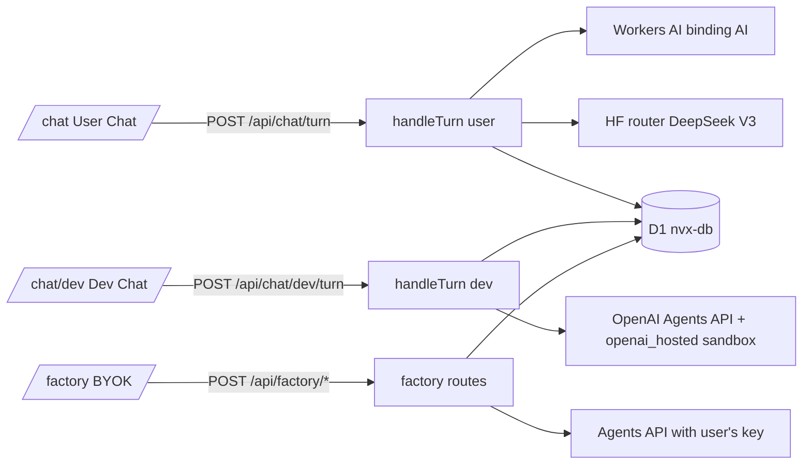

# Chat: User Chat, Dev Chat, Sandbox Factory

สามหน้าใช้คอมโพเนนต์ [`ChatApp`](../../src/components/chat/chat-app.tsx) ตัวเดียว และ handler ฝั่งเซิร์ฟเวอร์ร่วม [`turn-route.ts`](../../src/lib/chat/turn-route.ts)

## User Chat (`channel = 'user'`)

- โหมด `general | thai | code | strong | image` ([`plain-turn.ts`](../../src/lib/chat/plain-turn.ts))
- Workers AI ผ่าน binding `AI` ([`workers-ai.ts`](../../src/lib/ai/workers-ai.ts)) สตรีม delta เป็น SSE; `strong` ใช้ HF router ([`hf.ts`](../../src/lib/ai/hf.ts)); ล้มแล้วถอยไปอีกค่าย
- ภาพ: FLUX-1 schnell → bytes เก็บใน `attachment_blobs` (≤1.5 MB) เสิร์ฟที่ `/api/chat/images/<id>` เฉพาะเจ้าของ cookie
- โควตา: `messageRules` / `imageRules(…,"user")` ใน [`limits.ts`](../../src/lib/chat/limits.ts) day bucket ตามเวลาไทย
- ความรู้ Cloudflare Agents chat client SDK: คำถามที่เกี่ยวกับ SDK นี้ (useAgent, useAgentChat, AgentClient, tools, approvals ฯลฯ) จะได้โน้ตสั้นๆ จาก [`agents-chat-sdk.json`](../../src/lib/chat/knowledge/agents-chat-sdk.json) ที่คัดด้วย keyword ใน [`retrieve.ts`](../../src/lib/chat/knowledge/retrieve.ts) ต่อท้าย system prompt (ไม่เกิน ~1400 ตัวอักษร คำถามอื่นไม่เพิ่ม token) หน้าคู่มือสาธารณะคือ [integrations/cloudflare-agents-chat-sdk.md](../integrations/cloudflare-agents-chat-sdk.md)
- Persona ตามเว็บ: proxy `/api/chat` ของ implemented.stream ส่ง `x-nvx-site: implemented.stream` เครื่องยนต์จึงแนะนำตัวเป็น Bugbot จาก implemented.stream และไม่ชี้ไปหน้าเฉพาะ devstack.bid ส่วน `x-nvx-proxy-key` + `x-nvx-client-ip` ใช้ IP ผู้ใช้จริงกับโควตาต่อ IP เมื่อ key ตรงกับ secret `CHAT_PROXY_KEY` ([`trusted-proxy.ts`](../../src/lib/server/trusted-proxy.ts)) โน้ตที่ proxy รุ่น v10.5.0 แนบมาท้ายข้อความถูกตัดทิ้งก่อนบันทึก

## Dev Chat (`channel = 'dev'`)

- [`turn.ts`](../../src/lib/chat/turn.ts) สร้าง/ต่อ session ของ Agents API ด้วย config inline จาก [`agents/orchestrator/agent.json`](../../agents/orchestrator/agent.json) แปลง event เป็น `UiEvent` ([`events.ts`](../../src/lib/chat/events.ts)) สำหรับแผง Sandbox
- function tool (`search_docs`, `generate_image`, `plan_site`) รันใน Worker
- guard: `agentRules` (5/คน/วัน, 30/ทั้งเว็บ) + งบ `CHAT_DAILY_BUDGET_USD` (micro-USD ใน `usage_counters` scope `cost:global`)

## Sandbox Factory

- key ของผู้ใช้มากับ header `x-openai-key` ทุกคำขอ ([`factory.ts`](../../src/lib/chat/factory.ts)) ไม่เก็บ ไม่ log
- `POST /api/factory/session` สร้าง agent + session (`openai_hosted` หรือ `self_hosted`) บันทึก conversation `source='factory'`
- `GET /api/factory/watch` สตรีมสถานะ environment (pending/connected/failed) สูงสุด 10 นาที
- guard: per-IP ต่อชั่วโมง + `NVX_FACTORY_LIMITER`

## Self-hosted executor ของเรา (devbox)

กล่องพัฒนาของเรารัน `codex exec-server` ภายใต้ supervisor (`/opt/nvx-agent/devbox`, คำสั่ง `devboxctl start|stop|restart|status|ensure|logs`) เป็นผู้ใช้ `nvxagent` โดยมีแค่ `CODEX_API_KEY`, `HOME`, `PATH` ใน env ใช้สำหรับทดสอบ self-hosted เท่านั้น ไม่ได้ให้บริการแชตสาธารณะ

## ค่าใช้จ่ายโดยประมาณ

| ส่วน | ราคา |
|---|---|
| Workers AI | ฟรี 10,000 neurons/วัน (รีเซ็ต 00:00 UTC) แล้ว $0.011/1k neurons; Gemma 4 ≈ $0.10/$0.30 ต่อ M token; ภาพ FLUX ≈ 58 neurons (~$0.0006) |
| HF DeepSeek V3 | ตัดจากเครดิต HF Pro |
| Dev Chat (gpt-6.1-sol) | $2 / $0.10 cached / $10 ต่อ M token; turn ง่าย ≈ $0.01–0.06, turn หนัก ≈ $0.25 |
