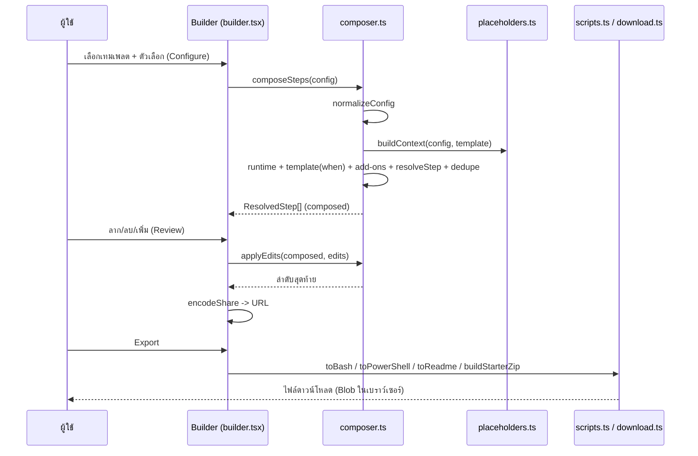
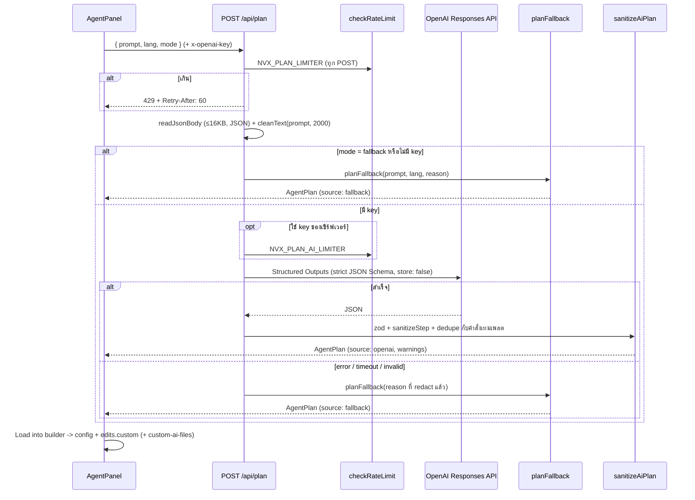

# การไหลของข้อมูล · Data flow

หน้านี้ติดตามข้อมูลผ่านระบบในสามสถานการณ์หลัก: เลือกเทมเพลตแล้วส่งออก, ขอแผนจาก AI, และเปิดลิงก์แชร์ เพื่อให้ผู้แก้โค้ดรู้ว่าการเปลี่ยนที่จุดหนึ่งกระทบส่วนไหน

## 1. เลือกเทมเพลต → ปรับ → ส่งออก

ข้อสังเกต: `composeSteps` ถูก memo ตาม `config` และ `applyEdits` ตาม `[composed, edits]` การเปลี่ยน config จึงคำนวณใหม่ทั้งหมด แต่การลากสลับคำนวณเฉพาะ `applyEdits`

## 2. ขอแผนจาก AI

ทุกเส้นทางยกเว้น 400/413/415/429 ได้ HTTP 200 พร้อม AgentPlan เสมอ client จึงจัดการรูปแบบเดียว

## 3. เปิดลิงก์แชร์

1. `readInitialState()` อ่าน `#s=` → `decodeShare` (base64url → JSON → zod → `normalizeConfig` → `sanitizeStep` ต่อขั้น)
2. สำเร็จ → stage = Review และแสดง toast; ล้มเหลว → ลอง `#t=` → ลอง localStorage → ค่าเริ่มต้น
3. ระหว่างใช้งาน event `hashchange` ทำให้การวางลิงก์ใหม่ในแถบที่อยู่โหลดสแต็กใหม่ได้ทันที

## ขอบเขตของข้อมูล (data boundaries)

| ข้อมูล | อยู่ที่ไหน | ออกจากเบราว์เซอร์ไหม |
|---|---|---|
| config + edits | URL fragment, localStorage | ไม่ (fragment ไม่ถูกส่งไปเซิร์ฟเวอร์) |
| prompt | body ของ POST | ไป Worker และ OpenAI (ถ้าใช้ AI); ไม่ถูก log |
| user API key | header `x-openai-key` | ไป Worker → OpenAI ในคำขอนั้นเท่านั้น |
| server API key | Worker secret | ไม่ออกจาก Worker ยกเว้นใน Authorization header ไป OpenAI |
| ไฟล์ดาวน์โหลด | Blob ในเบราว์เซอร์ | ไม่ |

## ดูเพิ่ม

[overview.md](./overview.md), [ai-planner.md](./ai-planner.md), [scripts-and-share.md](./scripts-and-share.md)
