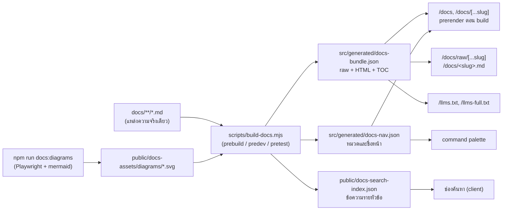

# ระบบเอกสารในแอป · Docs site (`/docs`)

หน้านี้เล่าว่าหน้า [devstack.bid/docs](https://devstack.bid/docs) ทำงานอย่างไร เราตั้งโจทย์ไว้สามข้อ: (1) เนื้อหามีแหล่งเดียวคือไฟล์ Markdown ใน `docs/` ไม่มีการเขียนซ้ำ (2) ทำงานบน Cloudflare Workers ซึ่ง **ไม่มี filesystem ตอน runtime** และ (3) ทั้งคนและ AI agent หยิบ Markdown ต้นฉบับไปใช้ได้จริง ไม่ใช่แค่อ่านบนเว็บ

## ภาพรวม pipeline

## ขั้นตอน build

`scripts/build-docs.mjs` รันอัตโนมัติก่อน `npm run build` (ซึ่ง `npm run cf:build` เรียก), `npm run dev`, `npm test` และ `npm run typecheck` ไฟล์ที่สร้างทั้งหมดอยู่ใน `.gitignore` จึงไม่มีวันเก่ากว่า `docs/`

1. **Parse** ด้วย remark-parse + remark-gfm (ตาราง, task list, strikethrough)
2. **แปลงเป็น HTML** ด้วย remark-rehype โดย **ทิ้ง raw HTML** ในไฟล์ Markdown
3. **Sanitize** ด้วย rehype-sanitize (schema แบบ GitHub) ลิงก์ `javascript:` และแท็กอันตรายถูกตัดทิ้ง
4. หลัง sanitize จึงแปลงต่อเฉพาะสิ่งที่เราควบคุมเอง: ใส่ `id` ให้หัวข้อ (rehype-slug ใช้กฎเดียวกับ GitHub จึงรองรับหัวข้อภาษาไทย), ปุ่ม `#` ข้างหัวข้อ, highlight โค้ดด้วย lowlight, แถบบนบล็อกโค้ดพร้อมปุ่มคัดลอก, ห่อตารางให้เลื่อนแนวนอนได้บนมือถือ
5. **ลิงก์** ระหว่างไฟล์ เช่น `../reference/api-plan.md` ถูกแปลงเป็น `/docs/reference/api-plan` ส่วนลิงก์ไปไฟล์โค้ด (เช่น `src/lib/composer.ts`) จะเป็นลิงก์ GitHub เมื่อตั้ง `NEXT_PUBLIC_REPO_URL` ไว้ ถ้าไม่ตั้งจะแสดงเป็นข้อความธรรมดา
6. **Mermaid** ถูกแทนด้วยไฟล์ SVG ที่เรนเดอร์ไว้ล่วงหน้า (ชื่อไฟล์คือ hash ของ source) หน้าเว็บจึงไม่ต้องโหลด JavaScript ของ Mermaid และไม่ต้องแก้ CSP ถ้าแก้ diagram แล้วยังไม่รัน `npm run docs:diagrams` บล็อกนั้นจะแสดงเป็นโค้ดแทน build ไม่พัง

## Route ที่ได้

| URL | ได้อะไร |
|---|---|
| `/docs` | หน้าแรกเอกสาร (จาก `docs/README.md`) |
| `/docs/<slug>` | หน้าเอกสาร เช่น `/docs/user-guide/getting-started` (slug = path ตัวพิมพ์เล็ก ไม่มี `.md`) |
| `/docs/<slug>.md`, `/docs/index.md` | Markdown ต้นฉบับแบบไบต์ต่อไบต์ `Content-Type: text/markdown; charset=utf-8` |
| `/docs/raw/<slug>` | ปลายทางจริงของไฟล์ดิบ (rewrite จาก `.md` ใน `next.config.ts`) |
| `/docs/agents/platform-manifest.json` | manifest แบบ JSON |
| `/llms.txt` | สารบัญลิงก์ไฟล์ดิบทุกหน้าตามรูปแบบ llmstxt.org |
| `/llms-full.txt` | ทุกหน้ารวมเป็นไฟล์เดียว |

slug ที่ไม่มีอยู่ได้ **HTTP 404 จริง** ผ่าน rewrite แบบเดียวกับ `/templates/<id>` (เพราะ `notFound()` ใน Cache Components จะ stream หลัง shell ที่เป็น 200) ไฟล์ดิบและ `llms*.txt` ส่ง `Access-Control-Allow-Origin: *` เพื่อให้เครื่องมือของคนอื่นดึงไปใช้ได้

## UI (Material 3 บนธีมดำของเรา)

- **Navigation drawer** ด้านซ้ายแบ่งตามหมวด (user-guide, concepts, architecture, history, operations, contributing, reference, agents) รายการที่เลือกอยู่ใช้สีแบบ "secondary container" และทุกปุ่มมี state layer ตอน hover/focus/กด
- บนมือถือมี **top app bar** เล็ก ๆ ใต้ header กดปุ่มเมนูเพื่อเปิด drawer แบบ modal จากซ้าย
- **ในหน้านี้ (TOC)** ด้านขวาบนเดสก์ท็อป ไฮไลต์หัวข้อที่กำลังอ่าน บนจอแคบเป็นกล่องพับได้เหนือเนื้อหา
- breadcrumb, ปุ่มก่อนหน้า/ถัดไป, ปุ่ม **คัดลอก Markdown**, **ดูไฟล์ดิบ** และ **แก้ไขบน GitHub** (ซ่อนไว้จนกว่าจะตั้ง `NEXT_PUBLIC_REPO_URL`)
- ฟอนต์ **Space Grotesk** (`next/font/google`, self-host) ใช้กับหัวข้อและ UI ของหน้าเอกสารเท่านั้น โหลดใน `src/app/docs/layout.tsx` หน้าอื่นจึงไม่ต้องดาวน์โหลด ตัวอักษรไทยใช้ IBM Plex Sans Thai โค้ดใช้ IBM Plex Mono เหมือนเดิม

## การค้นหา

ดัชนี `public/docs-search-index.json` มีหนึ่งรายการต่อหนึ่งหัวข้อ (ประมาณ 300 รายการ) โหลดครั้งแรกที่เริ่มพิมพ์เท่านั้น ตัวค้นหาใน `src/lib/docs-search.ts` จับคู่แบบ substring บนข้อความที่ normalize เป็น NFC และตัวพิมพ์เล็ก ภาษาไทยซึ่งไม่มีช่องว่างระหว่างคำจึงค้นได้โดยไม่ต้องตัดคำ คำที่คั่นด้วยช่องว่างต้องพบครบทุกคำ ผลจากชื่อหน้าได้คะแนนสูงกว่าหัวข้อ และหัวข้อสูงกว่าเนื้อหา

## ไฟล์ที่เกี่ยวข้อง

`scripts/build-docs.mjs`, `scripts/render-diagrams.mjs`, `src/lib/docs.ts`, `src/lib/docs-search.ts`, `src/app/docs/layout.tsx`, `src/app/docs/page.tsx`, `src/app/docs/[...slug]/page.tsx`, `src/app/docs/raw/[...slug]/route.ts`, `src/app/llms.txt/route.ts`, `src/components/docs/docs-shell.tsx`, `src/components/docs/doc-view.tsx`, `src/components/docs/doc-article.tsx`, `src/components/docs/doc-toc.tsx` และ test ใน `tests/docs-site.test.ts`
