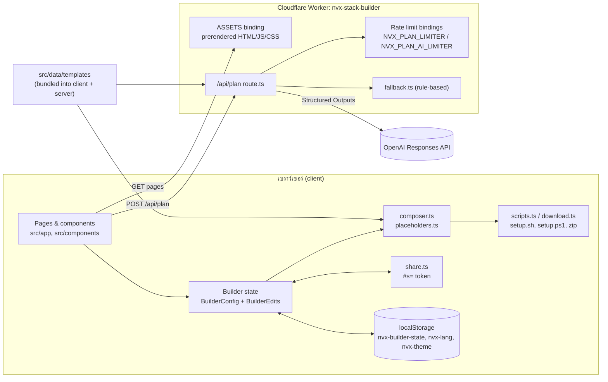

# ภาพรวมสถาปัตยกรรม · Architecture overview

NVX Stack Builder เป็นแอป Next.js 16.4 (App Router, React 19.3, TypeScript, Tailwind v4) ที่ **เกือบทั้งหมดทำงานฝั่ง client** มี endpoint ฝั่งเซิร์ฟเวอร์เพียงตัวเดียวคือ `/api/plan` และ deploy เป็น Cloudflare Worker ผ่าน OpenNext adapter (`@opennextjs/cloudflare`) ตั้งแต่ v0.3.0

## หลักการออกแบบ

1. **Data-driven** เทมเพลตเป็นข้อมูล การประกอบคำสั่งเป็นฟังก์ชันบริสุทธิ์ (pure function) ทดสอบได้โดยไม่ต้องมีเบราว์เซอร์
2. **Client-first, stateless server** การประกอบคำสั่ง สร้างสคริปต์ zip และลิงก์แชร์ทำในเบราว์เซอร์ เซิร์ฟเวอร์ไม่มีฐานข้อมูล ไม่มี session ไม่มีบัญชีผู้ใช้
3. **Text-only commands** ไม่มีการรันคำสั่งที่ใดเลย (ดู [safety-model](../concepts/safety-model.md))
4. **Graceful degradation** AI ล้มเหลวเมื่อไร ใช้ rule-based planner แทนเสมอ; rate-limit binding ใช้ไม่ได้ ใช้ in-memory แทน
5. **Prerendered pages** ทุกหน้า prerender ตอน build (`cacheComponents: true`) Worker จึงเสิร์ฟ static assets เป็นหลัก

## แผนภาพระบบ

## Subsystems

| Subsystem | ไฟล์หลัก | หน้าเอกสาร |
|---|---|---|
| Templates data | `src/data/templates/*`, `src/data/*-steps.ts`, `src/data/template-ids.ts` | [templates-and-composer.md](./templates-and-composer.md) |
| Composer + placeholders | `src/lib/composer.ts`, `src/lib/placeholders.ts`, `src/lib/types.ts` | [templates-and-composer.md](./templates-and-composer.md) |
| Script generators + downloads | `src/lib/scripts.ts`, `src/lib/download.ts`, `scripts/export-template.ts` | [scripts-and-share.md](./scripts-and-share.md) |
| Share encoding | `src/lib/share.ts` | [scripts-and-share.md](./scripts-and-share.md) |
| Sanitizer | `src/lib/sanitize.ts` | [safety-model](../concepts/safety-model.md) |
| AI route + planner + validation | `src/app/api/plan/route.ts`, `src/lib/ai/*` | [ai-planner.md](./ai-planner.md) |
| Rate limiting, env, HTTP limits, security headers | `src/lib/server/*`, `src/lib/rate-limit.ts`, `src/lib/security-headers.ts`, `next.config.ts`, `public/_headers` | [api-hardening.md](./api-hardening.md) |
| UI framework | `src/app/tokens.css`, `src/app/globals.css`, `src/components/ui/*`, `src/components/brand/*` | [ui-framework.md](./ui-framework.md) |
| Cloudflare / OpenNext runtime | `wrangler.jsonc`, `open-next.config.ts`, `scripts/patch-opennext.mjs`, `cloudflare-env.d.ts` | [cloudflare-runtime.md](./cloudflare-runtime.md) |
| Chat data model (D1, schema only) | `migrations/*.sql`, binding `DB` | [chat-data-model.md](./chat-data-model.md) |

## เส้นทาง (routes)

| Route | ประเภท | หมายเหตุ |
|---|---|---|
| `/` | prerendered | หน้าแรก hero + how it works + เทมเพลต + features ปุ่ม Ask the AI agent ไปที่ `/learn` |
| `/learn` | prerendered | หน้าเปิดตัวพรีเซนต์ทั้งระบบ จัดทำโดยผู้สร้าง devstack.sdk@gmail.com และ Cursor ปุ่มตั้งค่า Cursor (สร้างหรือถาม) อยู่ในหัวเว็บทุกหน้า |
| `/templates` | prerendered | catalog (ค้นหา/กรองฝั่ง client) |
| `/templates/[id]` | prerendered ต่อ id | id ไม่รู้จัก → rewrite ไป `/__nvx_not_found` เพื่อ HTTP 404 จริง |
| `/builder` | shell prerendered, builder render ฝั่ง client | อ่าน URL hash + localStorage จึงต้องเป็น client-only (`builder-loader.tsx`) |
| `/design` | prerendered | style guide |
| `GET /api/plan` | dynamic | `{ serverKeyConfigured, model }` |
| `POST /api/plan` | dynamic | สร้าง AgentPlan |

## ดูเพิ่ม

[data-flow.md](./data-flow.md), [file-map.md](../reference/file-map.md), [SUBSYSTEM-HISTORY.md](../history/SUBSYSTEM-HISTORY.md)
