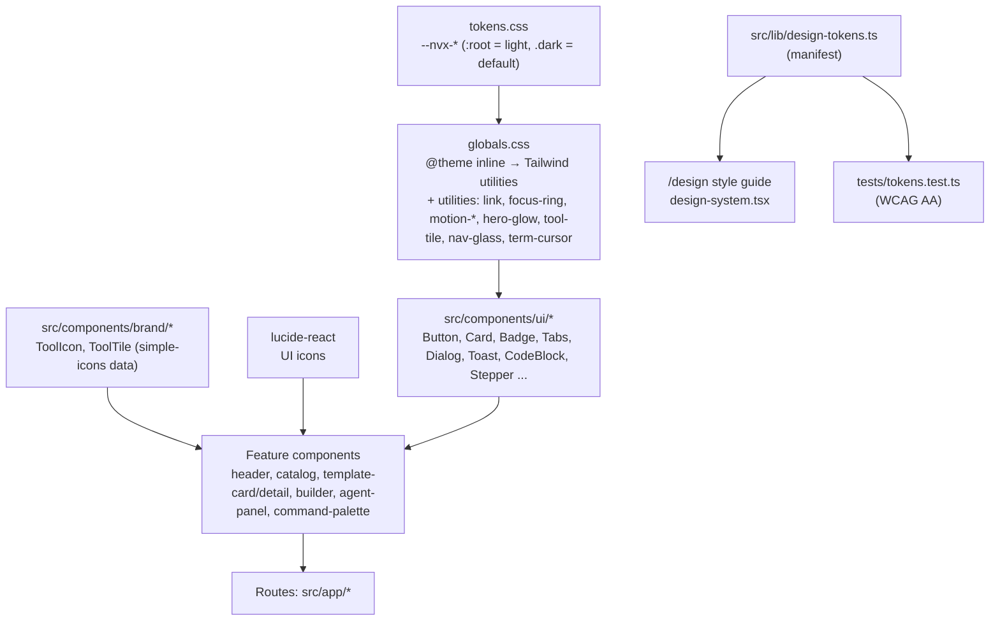

# Subsystem: UI framework (NVX UI)

เอกสารเทคนิคเต็มของระบบดีไซน์อยู่ใน [UI-FRAMEWORK.md](../UI-FRAMEWORK.md) (TH + EN) หน้านี้สรุปโครงสร้างในมุมสถาปัตยกรรม และวิธีที่ชิ้นส่วนเชื่อมกัน แนวคิดดู [concepts/design-system.md](../concepts/design-system.md)

## ชั้นของระบบ

## ไฟล์สำคัญ

| ไฟล์ | หน้าที่ |
|---|---|
| [`src/app/tokens.css`](../../src/app/tokens.css) | ค่าสีทั้งหมด (`--nvx-bg`, `--nvx-primary`, `--nvx-link`, code-*, chrome-*, tile-*, glow-*), เงา, motion; `.dark` override; reduced motion ตั้ง duration เป็น 0.01ms |
| [`src/app/globals.css`](../../src/app/globals.css) | map token → Tailwind (`--color-*`), ฟอนต์ (`--font-sans` = Inter → Plex Sans Thai, `--font-mono` = Plex Mono), radius, keyframes, utilities |
| [`src/app/layout.tsx`](../../src/app/layout.tsx) | โหลดฟอนต์ด้วย `next/font`, `<html class="dark ...">`, สคริปต์ pre-paint (ธีม + ภาษา), providers |
| [`src/components/prefs.tsx`](../../src/components/prefs.tsx) | `useLang`, ธีม/ภาษาผ่าน `useSyncExternalStore` (SSR snapshot: dark) |
| [`src/components/ui/index.ts`](../../src/components/ui/index.ts) | barrel export ของคอมโพเนนต์ทั้งหมด |
| [`src/components/ui/button-classes.ts`](../../src/components/ui/button-classes.ts) | `buttonClasses()` variant × size (ใช้ร่วมกับ Link ผ่าน `asChild`) |
| [`src/components/brand/tool-icon.tsx`](../../src/components/brand/tool-icon.tsx) | `ToolIcon`, `ToolTile`, `templateTool`, `tagTool`, `commandTool`, `addonTool` |
| [`src/components/brand/brand-icons.data.ts`](../../src/components/brand/brand-icons.data.ts) | path SVG 31 โลโก้ สร้างโดย [`scripts/gen-brand-icons.mjs`](../../scripts/gen-brand-icons.mjs) |
| [`src/components/brand/mascot.tsx`](../../src/components/brand/mascot.tsx) | มาสคอต `Mascot`: ภาพตัว + ตา SVG, ตามองตามเมาส์, squish; CSS อยู่ใน `globals.css` (`.nvx-mascot*`) |
| [`scripts/gen-brand-assets.py`](../../scripts/gen-brand-assets.py) | สร้างโลโก้ทุกขนาด, favicon, app icon, OG image และภาพตัวมาสคอตที่ลบตาออก จาก [`assets/brand/nvx-logo-master.png`](../../assets/brand/nvx-logo-master.png) |
| [`src/lib/design-tokens.ts`](../../src/lib/design-tokens.ts) | manifest ของ token (ชื่อ คำอธิบายสองภาษา) สำหรับ `/design` และ test |
| [`src/components/design-system.tsx`](../../src/components/design-system.tsx) | style guide `/design` |

## การตัดสินใจเชิงสถาปัตยกรรม

- **Radix UI สำหรับส่วนที่โต้ตอบ** (dialog, tabs, tooltip, toast, switch, checkbox, slot) ได้ accessibility ครบโดยไม่ต้องเขียนเอง (`f673199`, `4ac2756`)
- **cmdk** สำหรับ command palette, **dnd-kit** สำหรับลากจัดลำดับพร้อมคีย์บอร์ดและประกาศสำหรับ screen reader สองภาษา
- **ธีมผ่าน class `.dark`** ที่เซิร์ฟเวอร์เรนเดอร์ไว้ก่อน → ไม่มี flash, ไม่ต้องรอ JS
- **โลโก้แบบ generate** แทนการ import simple-icons ทั้งแพ็กเกจ (ใหญ่มาก) เพื่อให้ Worker bundle เล็ก simple-icons เป็น devDependency เท่านั้น
- **มาสคอตแบบเลเยอร์** (ภาพตัว + ตา SVG) แทน Lottie หรือไลบรารีแอนิเมชัน: ไม่เพิ่ม dependency ใช้แค่ transform จึงไม่เกิด layout/paint ซ้ำ ภาพตัวขนาด 2–22 KB และตาวาดด้วยพิกัดเดียวกับสคริปต์ที่ลบตาออก (test ตรวจว่าตรงกัน)
- **ไม่มีอีโมจิ** ใน `src/` (test บังคับ) เพราะแสดงผลไม่เหมือนกันในแต่ละ OS และดูไม่เป็นเครื่องมือมืออาชีพ

## Accessibility invariants

- คู่สีข้อความผ่าน WCAG AA (4.5:1) ทั้งสองธีม, non-text (ปุ่ม primary, ring) ผ่าน 3:1 — 32 คู่ใน `tests/tokens.test.ts`
- ปุ่มไอคอนอย่างเดียวต้องมี `aria-label`; ไอคอนตกแต่งต้อง `aria-hidden`
- โฟกัสมองเห็นได้เสมอ (`focus-ring`), toast ประกาศแบบ polite (error แบบ assertive)
- แอนิเมชันมาสคอตหยุดทั้งหมดเมื่อ `prefers-reduced-motion: reduce` และเป็น `aria-hidden` เว้นแต่ส่ง `label`
- ทุกหน้าไม่มี horizontal scroll ที่ 390px ทั้งไทยและอังกฤษ (ตรวจด้วย Playwright ทุกครั้งที่ปรับดีไซน์)

## ประวัติ

v0.2.0 สร้างทั้งระบบ (`3e5a8c2` tokens, `4ac2756` components, `7506507` app shell, `1b0f105` /design, `cd427e6` tests) → v0.4 terminal (`2210920`, `1219529`) → v0.5 Apple-inspired (`3dad906`, `b6e61a5`, `382750c`) รายละเอียดใน [SUBSYSTEM-HISTORY.md](../history/SUBSYSTEM-HISTORY.md)
