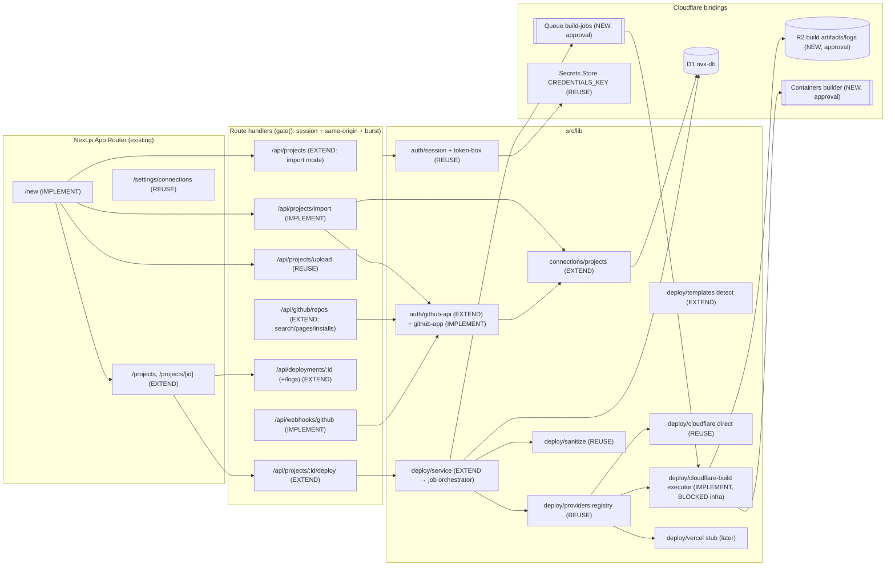

# Dependency Map

Build order follows the edges: D1 migration → project/import services → New Project UI → job state machine + queue → executor → preview URLs → webhooks.

## Critical path (text form)

1. **D1 migrations 0013–0016** (local only) — every later piece reads or writes these tables. They only add tables and columns, so the current `projects`, `deployments` and `audit_events` readers keep working.
2. **Project service extension** (`connections/projects.ts`) — slug, source, root directory and build settings, with every query still scoped by `user_id`.
3. **Import API** (`/api/projects/import`) — uses the existing OAuth token today and switches to GitHub App installation tokens once the owner registers the App.
4. **New Project UI** (`/new`) — calls only real APIs: import, upload and template create.
5. **Build orchestrator** (`deploy/service.ts` → job state machine) plus a Queue consumer. It needs the Queue, Containers and R2 bindings approved first.
6. **Preview/production environments** and **rollback**, which use Worker versions in the customer's account.
7. **Webhooks** (push / PR) with delivery-id idempotency. These need the GitHub App webhook secret.

Items 1–4 have no infrastructure blocker. Items 5–7 are blocked until the owner approves the items in CREDENTIALS-NEEDED.md.
